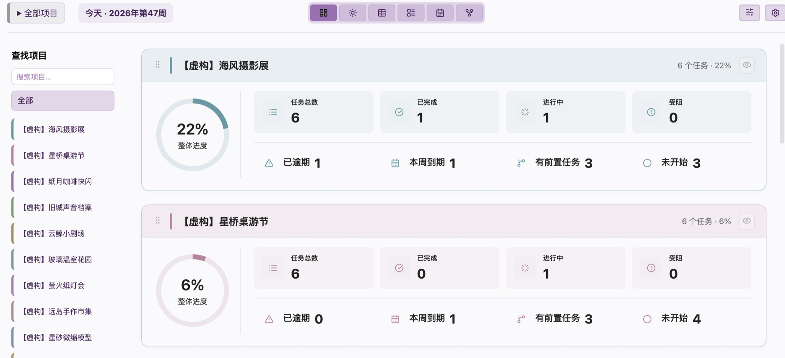
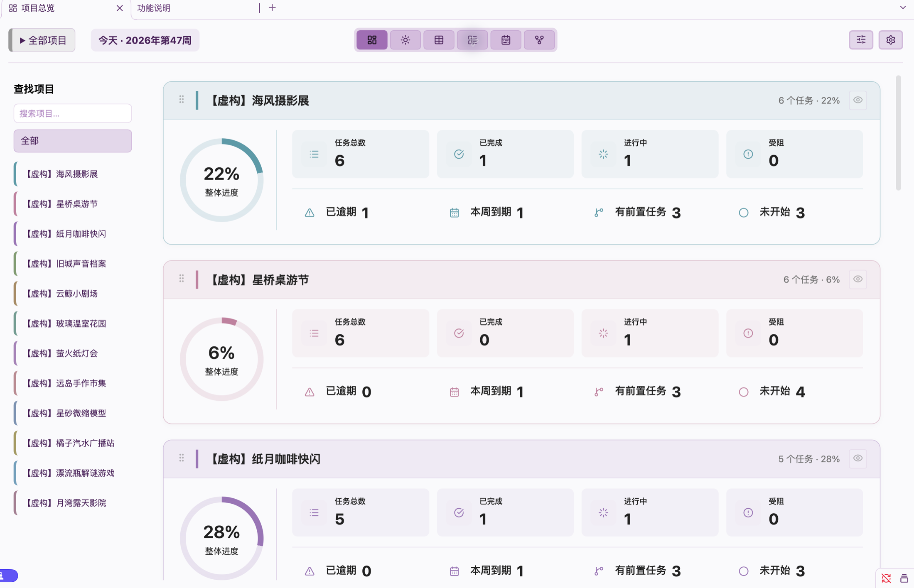
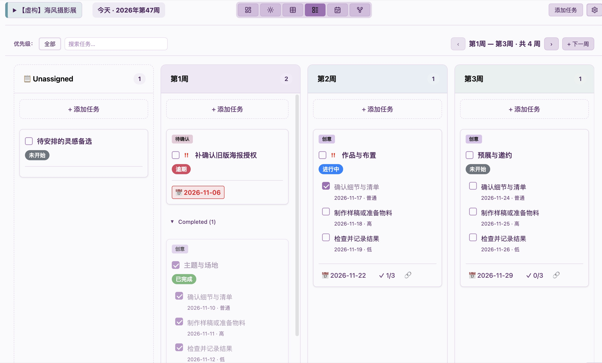
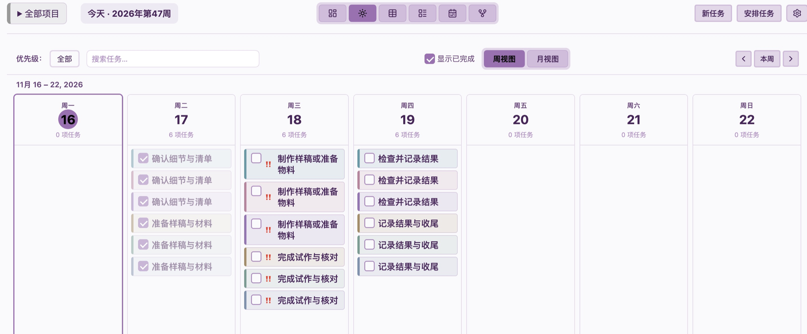
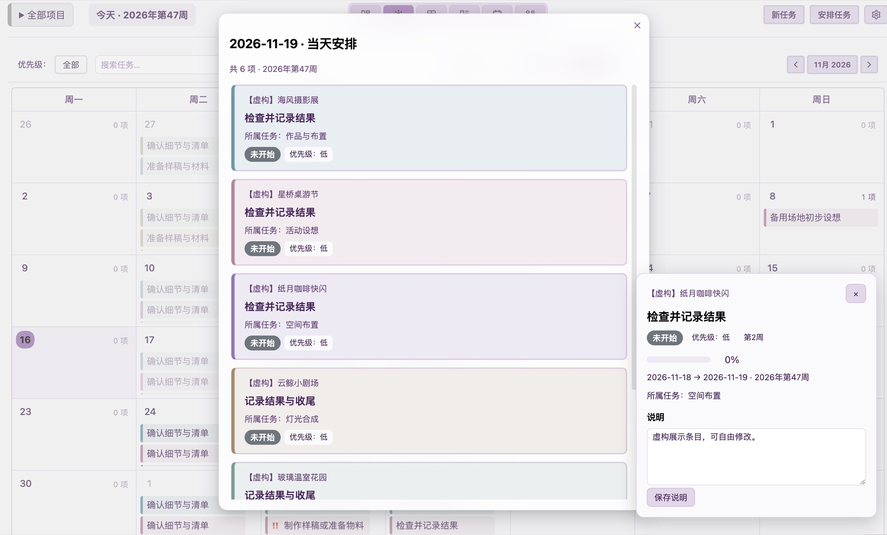
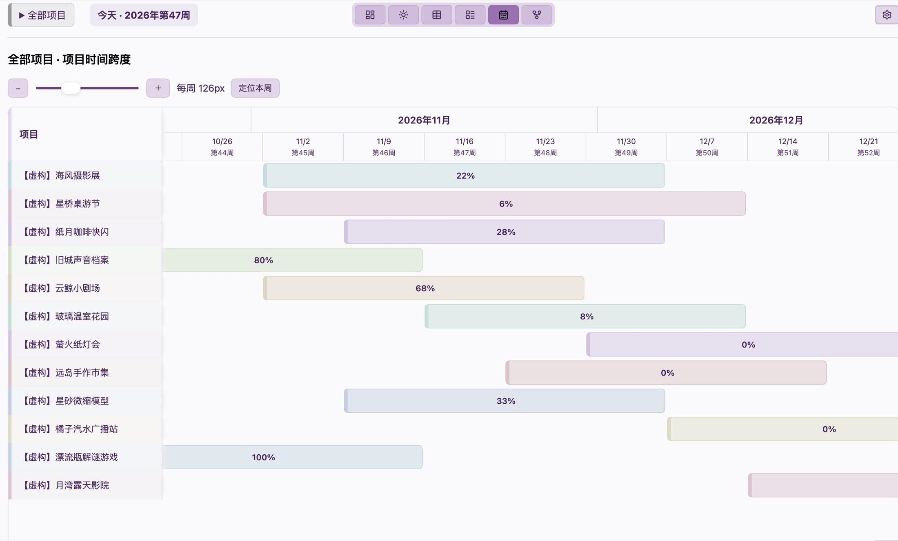

# Long Range Planner

用于 Obsidian 桌面端的长期项目规划插件，适合按周、月和多个阶段持续推进长期项目。当前版本 **1.16.77**，最低 Obsidian 版本 **1.5.0**。

## 界面展示

以下为真实 Obsidian 桌面端截图，展示内容均为虚构项目。主题和缩放设置可能影响外观。

### 项目总览

项目自身配色、整体进度和任务统计，配合左侧项目查找。



<details>
<summary>查看完整总览、周看板、周历、月历与时间轴</summary>

### 项目总览完整页面

项目颜色、整体进度及任务统计在同一页面集中呈现。



### 周看板

按阶段组织任务，展示子任务、日期、优先级和完成状态。



### 周历

按项目颜色查看一周任务和有日期的子任务。



### 月历与当天安排

日期格内显示任务数量；打开当天列表后，还可查看任务浮卡。



### 时间轴

比较多个项目的时间跨度与整体进度。



</details>

## 核心功能与近期升级

插件提供**项目总览、周月日历、表格、周看板、时间轴、依赖图**六个视图，共用顶部项目范围切换与全套项目/任务状态口径：

- **项目分组与管理**：支持项目分组、分组内排序与虚拟未分组兜底；提供管理卡片用于建组、改名、移除组、批量调组与二次确认安全删除。第 1/4/6 视图（总览、周看板、依赖图）共用左侧可搜索、可按状态筛选的项目查找栏，支持单击定位与双击进入。
- **项目概括与继承标签**：周看板支持折叠式项目概括卡片（简介与目标、实现思路、阶段规划及预计所需时长）以及项目级标签管理；项目标签会以只读形式自动继承到本项目的所有任务与视图中。
- **任务评分、费用预算与复盘**：支持按项目开启“平时分 / 考验分”双权重评分统计与柱状/排名分析弹窗；支持任务预计与实际费用录入、项目总预算差额（节余/超支）报表；项目全部完成或全部放弃后解锁项目复盘记录。
- **周分组绑定实际日历周**：每个周分组可绑定对应的 ISO 日历周（支持跳周与手动调整周号）；在已绑定周新建大任务或拖动/切换未改日期的任务时，自动填充目标周的周一至周日默认日期。
- **周月日历与当天清单升级**：周一开始显示，按项目配色；展示有日期的子任务及无子任务的独立大任务，支持直接拖拽更改截止日期、周/月每日角标显示“已完成/总数 项”；日期区间内的未完成任务自动显示“进行中”；点击日期可打开保持滚动位置的当天任务清单。
- **时间轴与依赖图增强**：时间轴支持无限向前/向后延伸、缩放与打开/切回自动定位本周，旧深色分组在时间轴自动柔化显示；依赖图按窗口宽度每行 2–4 个层级蛇形折行并支持完整名称换行。
- **交互细节与状态稳定性**：除周看板外点击任务以小浮卡打开并支持说明原地编辑；任务与子任务勾选框与名称首行垂直居中对齐；按视图和项目独立记忆滚动与折叠位置；强化多项目异步渲染隔离、读取保护与防串写机制。
- **可选 macOS 苹果提醒事项与日历双向同步（macOS 14+）**：通过本地 Swift EventKit 辅助程序与苹果提醒事项专用列表建立关联，在苹果提醒事项和苹果日历“计划的提醒事项”中双向同步完成状态（Windows/Linux 用户或未启用此功能的用户不受任何影响）。

## 手动安装

1. 前往本仓库 [Releases](../../releases) 页面下载最新版本的 `main.js`、`styles.css`、`manifest.json`（或直接从仓库根目录获取这三个文件）。
2. 在笔记库中创建 `.obsidian/plugins/long-range-planner/`，将上述三个文件放入其中。
3. 重启 Obsidian，在 **设置 → 第三方插件** 中启用 **Long Range Planner**。
4. 点击侧栏日历图标打开规划面板，点击右上角 **＋ 新建项目** 开始使用。

> 首次安装使用空白项目配置，不附带任何笔记库、个人项目或演示数据。若之前使用过其他规划插件，本插件使用独立目录与配置，不会自动覆盖或导入其他插件的数据。

### 可选：启用 macOS 苹果提醒事项同步（macOS 14+）

若需在 macOS 上同步有日期的任务与子任务到苹果提醒事项和日历，仓库中不直接分发预编译的 `.app` 二进制，请在安装目录就地构建本地辅助程序：

1. 将本仓库的 `apple-reminders-bridge.swift` 和 `build-apple-reminders.py` 一并放入 `.obsidian/plugins/long-range-planner/`。
2. 确保已安装 Xcode Command Line Tools，在插件目录执行：
   ```sh
   python3 build-apple-reminders.py
   ```
   构建并签名生成 `LrpRemindersBridge.app`。
3. 重启 Obsidian，在 **设置 → Long Range Planner** 中点击 **连接并同步** 并授予提醒事项权限。

完整操作说明、状态与进度口径及常见问题请参见 [使用说明](USER_GUIDE.md)。

## 本地数据

- 插件配置保存在 `.obsidian/plugins/long-range-planner/data.json`。
- 项目任务保存在笔记库 `long-range-planner/<项目目录>/.planner-tasks.json`。
- 苹果提醒事项同步关联记录（如启用）单独保存在插件目录 `apple-reminders-state.json`。
- 项目数据目录默认从 Obsidian 文件列表隐藏，普通 Markdown 文档仍可见；隐藏不会删除或移动文件。
- 更新时只需替换 `main.js`、`styles.css`、`manifest.json`（macOS 如更新了 Swift 源码可重新运行 `build-apple-reminders.py`），保留配置和任务数据；建议更新前备份笔记库。

本仓库仅包含插件代码、文档、构建脚本和合成测试，未包含用户配置、任务数据、笔记库、个人部署脚本或预编译二进制。

## 开发与验证

`main.js` 是可直接运行的完整插件；各辅助 JavaScript 模块也逐字内嵌于其中。修改辅助模块时，需要同步更新对应的 `main.js` 片段。

安装 Node.js 后执行全套回归测试：

```sh
npm test
```

测试脚本依次运行 `tests/check.cjs`、`tests/apple-reminders.cjs`、`tests/calendar-counts.cjs`、`tests/project-isolation.cjs` 和 `tests/timeline-current-week.cjs`，使用合成数据和 Obsidian 模拟对象覆盖周数边界、项目隔离、日历筛选与计数、时间轴本周定位、依赖图折行及苹果同步状态协调等核心逻辑。模拟回归不能替代真实 Obsidian 中的视觉验收；桌面端交互以中文界面为主。

## 来源与许可

基于 [Project Planner](https://github.com/ArctykDev/obsidian-project-planner) 修改，采用 [MIT License](LICENSE)。原项目版权声明予以保留。本项目为独立衍生版本，不代表原作者发布。
